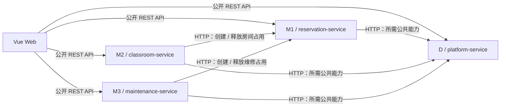
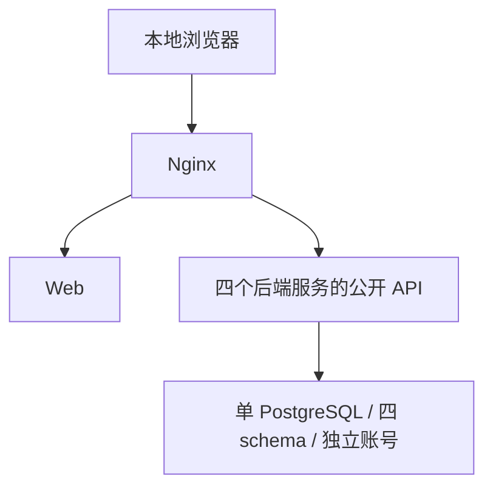
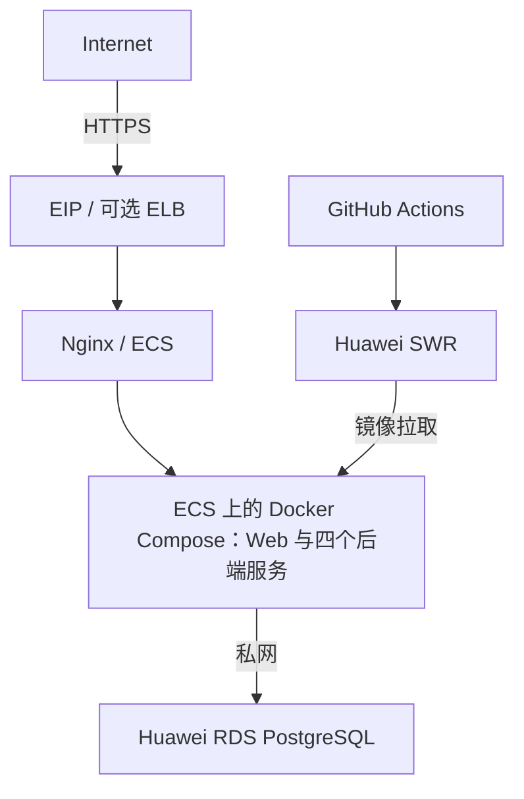

# 校园资源服务平台架构基线

状态：Phase6申请、两级审批、拒绝、前置撤销、超时与持久同步已实现，130项后端及首轮真实运行验收通过。D4/M1 V3/M2 V2/M3 V1，D36/M1 10/M2 6操作；schema/公共契约仍待草稿PR人工review。真实M1封房/释放留Phase8，当前403明确记SYNC_FAILED；完整Web留Phase9。验证和最终干净版本证据见[Phase6验收](../review/phase-6-validation.md)，完成后等待Phase7。

依据：[原始执行要求](../requirements/CODEX_EXECUTION_PROMPT.md)第 1–40 节及 Phase 0–15。完整需求和状态以 [REQUIREMENTS.md](../requirements/REQUIREMENTS.md) 与 [TRACEABILITY.md](../requirements/TRACEABILITY.md) 为准；数据归属见 [DATA_OWNERSHIP.md](DATA_OWNERSHIP.md)，边界决策见 [ADR-001](../adr/ADR-001-service-boundary.md)。

## 1. 架构范围与原则

采用 Monorepo、前后端分离、4 个后端服务、REST API 和 PostgreSQL。核心业务结果由确定性的业务规则、权限检查、状态机和数据库约束产生。优先保证真实运行、可测试、可追踪与简单维护。

Phase 0 为文档基线，Phase 1/2 建立工程和隔离数据库，Phase 3 交付 D 身份/资源/参数/每日码/审计，Phase 4 交付 M1 基础预约与来源账本。Phase 5 在同一边界内增加 M1 签到与持久提醒/NO_SHOW/违约、D 真实站内收件箱，保留独立账号和 HTTP 调用。Phase6追加M2申请审批与真实同步HTTP客户端；M3业务、M1占用写接口、完整Web及CI/CD仍按后续阶段实施。

禁止为课程项目引入 Kafka、Nacos、Consul、Service Mesh、Event Sourcing、CQRS 等非必要基础设施。第一版不使用 Redis，也不使用 Redis 锁、分布式事务或 BPMN 引擎。不得用生产 mock、假接口、假数据或默认成功掩盖缺失能力。

## 2. 服务职责与 HTTP 依赖

| 模块 | 服务 | 责任边界 |
|---|---|---|
| D 公共层 | `platform-service` | 用户、登录、RBAC、角色、权限、楼宇、教室、自习室、座位主数据、系统参数、签到码、通知接口、操作审计，以及本服务健康与版本信息 |
| M1 自习座位预约 | `reservation-service` | 自习室/座位/可用时间查询、创建与取消预约、签到、提醒、违约、历史和再次预约；统一拥有座位占用账本和房间并发锁；为 M2/M3 创建与释放房间占用 |
| M2 整教室预约与审批 | `classroom-service` | 整教室申请、多级审批、批准、驳回、撤销、审批超时撤销、审批状态和占用同步状态；通过 HTTP 请求 M1 占用或释放教室 |
| M3 物业报修工单 | `maintenance-service` | 故障上报、派单、开始维修、维修中、超时升级、完工、验收、评价、取消和占用同步状态；通过 HTTP 请求 M1 下架或恢复教室 |



图中箭头表示调用依赖，不表示共享数据库权限。D 是身份、空间主数据和公共能力的所有者；M1/M2/M3 访问这些服务数据必须通过 HTTP，具体公开契约须在相应阶段设计并人工 Review。Phase 3 的 D JWT 使用 HS256/issuer/audience/到期/authVersion 和实时 DB 权限；三个内部调用方使用独立 opaque 凭据，只有 M1 可验码。Phase 4 的 M1 每次将用户 JWT 转发 D `/api/v1/me` 获得当前身份/权限，另用专属 opaque 凭据读目录/参数；M1 不持有 D 签名秘密、不读 D 表。M2本轮增加当前本人范围及独立M1调用凭据；M3与正式组织政策留后续验证，方案仍待人工 review。

M1 的房间、座位查询可以结合 D 主数据与自身占用数据，但不能直接读取 `platform` 表。M2/M3 对教室不可用的影响只能经由 M1 占用 API；D 的空间主数据管理不能直接修改 M1 账本。未规定 M2 与 M3 直接相互调用。

D 的操作审计和通知是公共能力，各业务事件仍归相应模块。Phase 5 将提醒持久保存至 M1 outbox，再通过真实 HTTP 请求 D 幂等入箱，D 接收与 NOTIFICATION_ACCEPTED 审计同事务；M1 保存通知 ID/接收时刻。ACCEPTED 只证明 D 已持久接收，不声称邮件送达或用户已读。当前不增加通用远程审计写接口，不引入消息队列。

## 3. 固定技术栈

| 层次 | 技术 |
|---|---|
| 后端运行与框架 | Java 21、Spring Boot 3.x、Spring Security、Maven |
| 后端数据与接口 | MyBatis、PostgreSQL、Flyway、Bean Validation、OpenAPI 3 |
| 后端验证 | JUnit 5、Testcontainers、JaCoCo |
| 前端 | Vue 3、TypeScript、Vite、Vue Router、Pinia、Element Plus、Axios |
| 前端验证 | Vitest、Playwright |
| 容器与交付 | Docker、Docker Compose、Nginx、GitHub Actions |
| 华为云目标 | SWR、ECS、RDS PostgreSQL |
| 后续可选 | ELB、CCE、DCS Redis；第一版不使用 Redis，CCE 仅在 ECS + Compose 稳定后考虑 |

本表是完整目标选型；实际依赖版本以根 POM、各模块构建文件和 `pnpm-lock.yaml` 为准。前后端构建配置已在 Phase 1 建立，MyBatis、PostgreSQL 驱动、Flyway 与 Testcontainers 在 Phase 2 接入；当前D36/M1 10/M2 6个操作的 OpenAPI 随实际代码更新，正式校验结果以阶段记录为准；其他业务契约、完整 Web E2E、CI/CD 和云部署留后续阶段。

## 4. 数据所有权与并发边界

一个 PostgreSQL 实例容纳四 schema，各有独立 app/migrator。D V1–V3 的12张业务表保留，本轮 V4 增加 notification；M1 V2 四表保留，本轮 V3 增加 checkin、violation、reminder，并允许系统 NO_SHOW 事件使用空 actor ID；M2/M3 仍 V1。应用无 DDL/迁移历史权限，D 审计不能更新/删除，具体约束见[所有权](DATA_OWNERSHIP.md)。禁止跨 schema SQL/外键及借共享账号绕过 HTTP，跨服务实体只保留逻辑 ID。

D 拥有空间主数据；M1 拥有 `room_gate`、`seat_reservation`、`seat_occupancy`、`checkin`、`violation`、`reservation_event`。房间和座位“存在什么”与某时段“是否可用”是不同责任：不可用来源必须由 M1 账本表示，不能全部压缩为 `seat.status`。

所有改变房间座位状态的操作使用 M1 自有的 `room_gate(room_id PRIMARY KEY)`，在一个数据库事务中锁定对应房间行，检查占用并创建或释放占用后提交。覆盖 M1 创建/取消预约、M2 创建/释放教室占用和 M3 创建/释放维修占用。锁粒度为房间。D 不持有此锁，也不跨服务参与该本地事务。

Phase 4 在真实 D 校验后进入本地事务，INSERT ON CONFLICT 懒创建 room_gate，再 SELECT FOR UPDATE，锁后复核 Clock；首次同房间/同座位并发也不能绕过互斥。D HTTP 不占用该锁，只提供快照，不承诺与 M1 提交跨服务原子。D 资源停用/移动/删除与已有预约的协调和历史保留仍待明确。Phase 5 签到/NO_SHOW 继续使用同房间锁，M2/M3 写接口留对应阶段。

## 5. 占用契约与跨服务一致性

M2/M3 调用 M1 的源指定契约如下；本文保留基线路径，并不声称已提供可调用接口：

| 操作 | 契约 |
|---|---|
| 创建房间占用 | `POST /internal/v1/room-blocks` |
| 释放房间占用 | `DELETE /internal/v1/room-blocks/{sourceModule}/{sourceRefId}` |
| POST 字段 | `roomId`、`startAt`、`endAt`、`sourceModule`、`sourceType`、`sourceRefId` |
| 幂等唯一键 | `(source_module, source_ref_id, source_type)` |
| 重复创建 | 内容一致返回已有结果；内容冲突返回 `409 Conflict` |

M2 的 `sourceModule=M2`、`sourceType=CLASSROOM_BOOKING`；M3 的 `sourceModule=M3`、`sourceType=MAINTENANCE`，维修允许 `endAt=null`，表示没有指定结束时间，不能自行代入默认维修时长。

DELETE 路径缺少唯一键中的 `sourceType`。应在公共契约人工 Review 时明确是否限制 `sourceModule` 到唯一类型，或调整释放契约；本基线不擅自增加参数、扩大删除范围或认定不存在歧义。重复释放、已释放记录的再创建、冲突内容比较口径与响应内容也需确认。

不使用分布式事务。M2 批准和 M3 开始维修必须显式表示本地业务进度与 M1 同步进度：

```text
M2：APPROVING -> APPROVED_PENDING_SYNC -> 调用 M1 -> APPROVED
    同步失败：APPROVED_PENDING_SYNC -> 有界重试 -> SYNC_FAILED

M3：ASSIGNED -> BLOCKING_ROOM -> 调用 M1 -> IN_PROGRESS
    同步失败：有界重试耗尽 -> SYNC_FAILED
```

只重试网络错误和 HTTP 5xx；HTTP 4xx 不重试；源要求上限为“最多 3 次”。这 3 次是包含首次调用的总尝试次数，还是首次失败后的重试次数，源文档未明确，必须确认后再实现，不能隐含选择。4xx 的业务错误呈现和最终状态处理、重试间隔、执行载体、人工恢复入口与释放操作的同步状态也待设计。

网络超时可能发生在 M1 已提交但调用方未收到响应之后，因此调用方不能把超时直接等同于“没有占用”，也不能在尚未确认同步成功时报告 `APPROVED` 或 `IN_PROGRESS`。后续实现需依托约定的幂等键处理重复请求，并验证进程重启、重试耗尽和同步失败的真实行为。

## 6. 时间规则与业务状态

| 模块 | 源指定状态 |
|---|---|
| M1 预约 | `CREATED`、`CANCELLED`、`CHECKED_IN`、`NO_SHOW`、`COMPLETED` |
| M2 申请 | `SUBMITTED`、`APPROVING`、`APPROVED_PENDING_SYNC`、`APPROVED`、`REJECTED`、`CANCELLED`、`AUTO_CANCELLED`、`SYNC_FAILED` |
| M3 工单 | `REPORTED`、`ASSIGNED`、`BLOCKING_ROOM`、`IN_PROGRESS`、`WAITING_ACCEPTANCE`、`COMPLETED`、`CANCELLED`、`SYNC_FAILED` |

M1 本轮按带 offset 输入转 Instant，在显式业务时区校验整点/正整数小时；区间为 `[start,end)`，相邻允许。新建/再预约开始不得早于 Clock，读取 D 本次最大时长快照（初始 4）；不追溯改写旧预约、不私加未来天数或一人多座限制。创建前检查所有 ACTIVE 来源，同座位或 seat_id=null 整房间均冲突，end_at=null 持续生效，返回 409。目录包含启用的 STUDY_ROOM/CLASSROOM，支持真实插座筛选；本人 CREATED 只在开始前可取消，重复取消返回原结果；历史按取消或区间结束查询，再预约新建 ID，重新检查全部条件。以上为具体待审方案。

Phase 5 草案用 `[T−15min,T+15min)` 作为本人 CREATED 签到窗口；真实 D 校验预约房间当日码，M1 取得 room_gate→预约锁后复核 Clock/状态，写 CHECKED_IN、唯一 checkin 与事件。重复签到返回已有结果，不保存明文码。`now >= T+15min` 时仍 CREATED 的预约最终写 NO_SHOW，保留 cancelled_at=null，将原文“取消预约”解释为结束有效性；在同一事务精确释放 M1 来源、写唯一 violation 和系统 NO_SHOW 事件，任何异常回滚。不新增补签到、封号或积分，正常 COMPLETED 触发仍未定义。

D 在 Phase 3 的具体方案为每日每房间一个 8 位随机字符签到码，Clock/显式 ZoneId 决定今日、room/date 主键保证唯一、同日 ensure 不轮换；二维码载荷尚未实现。Phase 5 的 M1 经真实 D 验码后校验本人预约、窗口与账本并记录签到。首版不做 GPS、人脸识别、蓝牙和 NFC。

M2 第一版审批链为普通学生 → `ROOM_ADMIN` → `DEPARTMENT_ADMIN`。M3 使用 `due_at` 和定时扫描记录 escalation event 并在 UI 标记。Phase6每级审批激活默认24小时并封顶开始时间；维修时限和正常完成触发仍未定义。Phase 5 的签到/NO_SHOW 具体政策与 Phase 4 时间/取消草案均待人工 review，不据测试或阶段授权推定已批准。

提醒的有效窗口为首轮 `[T−15,T+10)`、次轮 `[T+10,T+15)`。独立扫描和发送任务默认各每30秒、每批100，调度池2，使 D 网络等待不阻塞 NO_SHOW 扫描。发送使用持久 claim/30秒 lease，最多3次总尝试，网络/5xx按30/60秒退避，4xx/坏响应终止。停机恢复优先处理过期 NO_SHOW，跳过失去意义的提醒；取消/签到抑制待发项。HTTP 在房间锁/事务外发送，发送前重查状态与到期，已在途的远端入箱不能与签到原子撤回，不能虚构跨服务回滚。

## 7. API、安全与可观测性

公开 API 使用 `/api/v1`，服务内部 API 使用 `/internal/v1`。成功响应包含 `data`、`requestId`；错误包含 `code`、`message`、`requestId`。使用真实 HTTP 状态：200、201、204、400、401、403、404、409、422、500、503；204 的无响应体语义应在契约中明确，不能为统一封装强行附加 JSON，也不能把所有结果包装成 HTTP 200。

第一版使用用户名/学号、密码和有过期时间的 JWT，密码采用 BCrypt；暂不接入学校统一身份认证。权限在后端验证，前端隐藏按钮仅用于交互。角色为 `STUDENT`、`ROOM_ADMIN`、`DEPARTMENT_ADMIN`、`PROPERTY_STAFF`、`PROPERTY_MANAGER`、`OPERATOR`、`SYSTEM_ADMIN`；角色的数据范围和具体授权矩阵需人工确认。

严格验证边界包括 HTTP 请求、JWT、权限、数据库约束、外部 HTTP 响应、状态机转换、环境变量；内部不重复 Bean Validation，不使用普遍 try/catch、无意义 Optional、默认成功或无限重试。

生产要求 HTTPS only、参数化 SQL、CORS 白名单、无默认生产密码、Git 无凭据、数据库仅私网、内部 API 不公开、生产 Swagger 受限。内部调用身份认证及来源模块防伪规则必须在开放内部契约前明确，不能把请求体 `sourceModule` 当作可信调用身份。

日志至少包含 `timestamp`、`level`、`service`、`requestId`、`userId`、`method`、`path`、`status`、`latencyMs`；不记录密码、JWT、refresh token、签到码明文或敏感个人信息。每个服务的 `/actuator/health` 和 `/actuator/info` 已在 Phase 1 分别实现，后者包含 `service`、`version`、`gitCommit`、`buildTime`；Phase 2 health 增加真实数据源连接检查，详情不对外暴露。D 在 Phase 3 已实现认证和模板化请求日志，实际日志抽查未出现本地私有凭据或生成码；M1 本轮接入远程身份、明确 CORS 和模板化请求/异常日志；实际全服务运行日志抽查仍以阶段证据为准，M2本轮已接入远程身份、CORS及模板化日志，M3随Phase7交付。

## 8. 本地与华为云目标拓扑

本地开发 Compose 已配置 `postgres`、四个后端服务、`web` 和 `nginx`，Phase 1 已完成工程骨架验收；`mailhog` 可选且当前未配置。Phase 2 数据库重放与整体验收单独记录。浏览器访问入口与服务内部通信分开，内部 API 和数据库不能通过公共入口暴露。



此图保留本地拓扑。当前仅 Nginx 绑定 loopback，默认 `127.0.0.1:18080`，代理 Vue、四服务只读运行信息，`/api/v1/reservation/...` 与 `/api/v1/reservations`（含子路径）及 `/api/v1/violations` 到M1，`/api/v1/classroom-requests`及子路径到M2，其余 `/api/v1/` 到D；后端实际验证身份、权限与个人范围。数据库与后端无宿主端口，`/internal` 不经公共网关暴露；M2已开放六个操作，M3尚未开放业务API。具体配置见 `compose.yaml`、`deploy/nginx/nginx.conf` 及[本地手册](../runbooks/local-development.md)；后续服务间 HTTP 调用走内部网络。



生产目标为 SWR + ECS + RDS PostgreSQL + Nginx + HTTPS；生产数据库不放在应用 Compose 中。华为云验收要求公网仅开放 HTTPS、数据库无公网入口、镜像可拉取、CI/CD 可部署、健康与版本可追踪。ELB 可选，CCE 只能在 ECS + Compose 稳定后加入，且保持镜像、环境变量、健康端点和数据库不变。

PR 质量门包括后端 lint/test、前端 lint/unit test、集成测试、构建与 Docker build，任一步失败即停止。main 合并后的测试环境部署需构建并以 commit SHA 标记镜像、推送、迁移、启动、健康检查和 smoke test；生产通过 Git tag 和人工批准发布，记录 tag、commit SHA、image tag、migration version、deploy time、operator。

应用回滚通过 `RELEASE_TAG` 选择旧镜像，数据库优先采用向前兼容 schema，不依赖 migration downgrade。迁移仅向前，已执行/已发布迁移不得修改，修复须新建迁移；schema 与 seed 分离，并能从空库重放。上述发布流水线、`RELEASE_TAG` 配置和回滚能力均尚未实现。

## 9. 验证与分阶段交付

单元测试覆盖状态、时间、权限、最大预约时长、取消和超时；Testcontainers PostgreSQL 覆盖真实迁移、并发、房间锁、唯一约束和幂等；API 验证 401/403/正常请求/409/非法参数/角色隔离；Playwright 验证学生预约、签到、M2 审批到 M1 不可预约、M3 维修下架到验收恢复。至少一次人工 mutation-style 验证须确认改变业务规则会导致测试失败并恢复代码，记录真实结果。

| Phase | 允许进入的工作范围 |
|---|---|
| 0（历史基线） | 治理、需求与架构文档、目录；已交付 |
| 1（已交付） | 四个 Spring Boot 服务、Vue 应用、Dockerfile/Compose/Nginx、health/info |
| 2（已交付） | 四 schema、各自应用/迁移账号、Flyway、最小 seed |
| 3（已交付） | D 身份权限、资源、参数、签到码与审计 |
| 4（已交付） | M1 基础预约、真实 D HTTP、房间锁与占用账本 |
| 5（已交付） | M1签到、提醒、违约与释放；D持久站内收件箱 |
| 6（本轮） | M2申请审批、撤销与超时，生产真实HTTP client；完成后等待Phase7 |
| 7 | M3 工单、验收、评价与升级 |
| 8 | M2→M1、M3→M1 的真实跨模块集成及相应 E2E |
| 9 | 各角色完整 Web 流程 |
| 10 | 测试体系、跨服务验证及 `scripts/test-all.sh` |
| 11 | PR CI 质量门 |
| 12 | 测试环境自动部署 |
| 13 | 生产发布与回滚 |
| 14 | 华为云部署与验收 |
| 15（可选） | 前序全部完成后，开发只通过公开 API 的自然语言 Agent |

每次只执行一个 Phase，并在结束时列出文件、设计、实际命令、测试结果、未完成项和建议 commit，再等待人工确认。测试必须随对应业务验证，Phase 10 不意味着前序阶段可以无验证交付。

可选 Agent 只能把自然语言转为意图、API 工具调用和模板结果；参数不足必须追问，不可直连数据库或决定权限、审批、预约、座位、工单状态。不得先做 AI 推荐、AI 自动审批或用 AI 生成虚构运营内容。

## 10. 人工 Review 待确认事项

这些事项是后续实现的决策输入，尚未成为默认政策：

1. DELETE 路径与三元幂等键的一致性；重复释放、已释放后重用业务引用及请求内容冲突比较规则。
2. “最多 3 次”的计数含义、重试间隔/调度/恢复、4xx 最终状态及释放失败的同步状态。
3. D 主数据变更与 M1 锁行生命周期；资源停用/删除对已存在预约与占用的影响。
4. Phase 4 的整点/业务时区、半开区间、当前参数、开始前取消和历史再预约具体方案待 review；Phase 5 对签到窗口、NO_SHOW 和站内提醒已有具体待审方案；Phase6每级审批默认24小时并封顶开始时间形成待审草案；正常自动完成和维修超时仍未定。
5. D 的 JWT、独立内部身份、SYSTEM_ADMIN 全局/ROOM_ADMIN 显式范围已有 Phase 3 待审方案；其他模块接入、部门范围、站内通知已形成持久去重/有界恢复草案，通用跨服务审计失败处理与其他渠道仍未完成。
6. 违约、个人信息、审计及业务事件的保存周期；应在工程伦理记录中持续跟踪实际决定。

上述问题作为持续未决事项保留。Phase 3 对 D 日码/身份/范围/响应、Phase 4 对 M1 基础时间/取消/锁行/占用给出具体待审方案，Phase 5 对签到/违约/站内提醒形成具体待审方案，未替 M2/M3 释放重试和正常完成/保留生命周期作决定；数据库与公共契约仍须人工 Review，不能以测试、执行授权或上传仓库推定架构已获批准。

## Phase 6 当前实现与明确依赖

M2追加V2四表classroom_request、approval_step、approval_action、classroom_event；D仍V4/M1 V3/M3 V1，旧迁移不改写。D36/M1 10/M2 6操作。D本人room-scopes要求当前classroom:approve，ROOM_ADMIN/DEPARTMENT_ADMIN可显式分配房间；两角色均移除则清除范围，D空间维护仍按原ROOM_ADMIN/系统管理员规则，部门范围不扩大空间或取码权限。不新增部门模型或seed用户。

M2通过真实D HTTP验证身份/权限/范围和启用CLASSROOM，无D签名秘密/跨schema SQL。SUBMITTED等待ROOM_ADMIN，第一次批准APPROVING激活DEPARTMENT_ADMIN，第二次仅APPROVED_PENDING_SYNC。两级要求当前对应角色/权限/范围，禁止自批及同一人两级，无SYSTEM_ADMIN隐式覆盖。每级激活默认24小时并封顶startAt，记录锁后复核Clock；未完成审批到期AUTO_CANCELLED。只允许本人取消SUBMITTED/APPROVING且期限前。

同步通过独立M1_CLASSROOM_TOKEN真实POST M1 room-blocks，来源classroom-request:ID；30秒持久lease/令牌、3次总尝试、网络/5xx退避30/60秒、4xx/坏回执终止。两个30秒任务/池2，HTTP不持本地锁，迟到回执核对状态/令牌。当前真实M1接口属于Phase8尚未提供，直接403正确记SYNC_FAILED，不制造APPROVED或M1占用。客户端成功回执分支仅由明确外部响应夹具验证；批准后取消/到期释放/未知提交补偿与真实封房仍留Phase8。

完整clean reactor130项通过，运行升级与最终SHA证据见[Phase6验收](../review/phase-6-validation.md)。早期Phase0–5文字保留历史，不能把旧阶段未实现描述当作当前M2不存在，也不能把当前M2审批当作Phase8已完成。Phase6结束等待Phase7，完整Web在Phase9。
